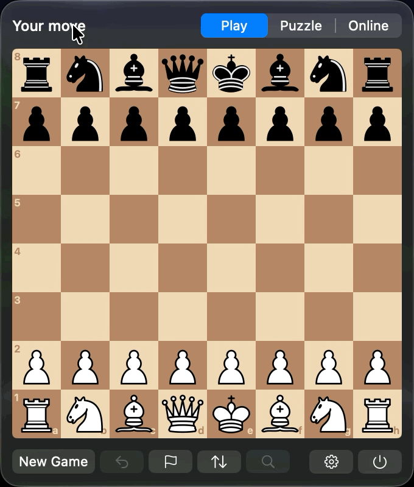

# Knightbar

[](https://github.com/jonasgrau/knightbar/actions/workflows/tests.yml)

Chess in your Mac's menu bar. Click the knight and a small board opens: play against
Stockfish, solve the daily puzzle, or make your move in a Lichess correspondence game.
A dot on the knight tells you when it is your move on Lichess or Chess.com.

<p align="center">
  
</p>

## Features

- **Play against the computer.** Stockfish 19 at eight levels, from about 1320 Elo to full
  strength. Choose your colour and the engine's thinking time. Take back moves, resign, and
  open the game on the Lichess analysis board (right-click that button to copy the game as
  PGN instead). The game is saved after every move and continues after a restart.
- **Daily puzzle** from Lichess or Chess.com. Wrong moves are rejected, a hint shows the piece
  and then the move, and solved puzzles are remembered.
- **Lichess correspondence games** right in the popover: log in with your Lichess account,
  see your games and challenges, accept or decline challenges, challenge a friend, offer or
  accept a draw, resign.
- **Chess.com daily games:** enter your username and Knightbar lists the games in which it is
  your move. A click opens the game on chess.com.
- **Menu bar dot and optional notifications** when it is your move on Lichess or Chess.com.
- **Opens at login** if you like, so the dot is always there (Settings → Open at login).
- **Tells you about new versions:** a dot on the settings gear and a download link, or the
  `brew upgrade` command if you installed with Homebrew.
- Two players on one board, flip the board, click-click or drag-and-drop moves.

## Requirements

macOS 14 Sonoma or later, on Apple Silicon or Intel.

## Installation

### Download

1. Download `Knightbar-<version>.dmg` from the
   [latest release](https://github.com/jonasgrau/knightbar/releases/latest), open it and drag
   Knightbar into your Applications folder.
2. Open it. Knightbar is not notarized by Apple yet, so macOS blocks the first launch:
   - Close the warning with **Done**.
   - Open **System Settings → Privacy & Security**, scroll down to **Security** and click
     **Open Anyway** next to the message about Knightbar.
   - Confirm with your password and click **Open**.

   This is only needed once.

### Homebrew

```sh
brew tap jonasgrau/tap
brew trust --cask jonasgrau/tap/knightbar   # Homebrew only loads casks from other taps once you trust them
brew install --cask knightbar
```

The first launch needs the same **Open Anyway** step as above. Update with
`brew upgrade --cask knightbar`.

Knightbar has no Dock icon. Look for the knight in the menu bar.

**Don't see the knight?** When the menu bar is full, macOS hides the items that do not fit,
especially while an app with many menus is in front. Switch to the Finder to make room, or
remove some other menu bar items. On recent macOS versions, also check that Knightbar is
allowed under **System Settings → Menu Bar**.

To check a download, compare its checksum with the matching `.sha256` file of the release:

```sh
shasum -a 256 Knightbar-<version>.dmg
```

## Privacy

Knightbar collects no data and has no telemetry. It only talks to:

- **lichess.org** for the daily puzzle and, after you log in, your correspondence games.
  The login asks for the `board:play` permission only. The access token is kept in your
  keychain; **Log Out of Lichess** revokes it.
- **api.chess.com** for the daily puzzle and the list of your daily games where it is your
  move. No login, only your public username.
- **api.github.com** once a day to see whether a newer Knightbar release exists. Nothing is
  sent besides the request itself. Turn it off under Settings → Check for updates
  automatically.

Games, settings and the list of solved puzzles stay on your Mac.

## Fair play

Lichess games in Knightbar get no help: no engine, no evaluation, no hints. Stockfish only
plays in the games against the computer.

## Building from source

You need Xcode 16 or later (Knightbar is developed with Xcode 27).

```sh
git clone https://github.com/jonasgrau/knightbar.git
cd knightbar
./scripts/fetch-stockfish.sh      # downloads the official Stockfish release, checks its SHA-256
open Knightbar.xcodeproj          # then build and run the Knightbar scheme
```

The chess logic lives in the Swift package `ChessCore` (rules with perft tests, FEN, SAN, PGN,
the UCI engine client, puzzles, and the Lichess and Chess.com clients). Run its tests with:

```sh
cd ChessCore && swift test
```

`./scripts/make-release.sh` builds a universal release and packs it as a `.zip` (for Homebrew)
and a `.dmg` in `dist/`.

`./scripts/publish-release.sh <version>` does the whole release: version bump, tests, build,
GitHub release and Homebrew cask update. Try it first with `--dry-run`.

## Credits and licence

Knightbar is free software under the [GNU General Public License v3.0](LICENSE).

- [Stockfish](https://stockfishchess.org), the chess engine, GPLv3.
- The "cburnett" chess pieces by Colin M.L. Burnett, GPLv2+, as used by
  [Lichess](https://github.com/lichess-org/lila).
- Daily puzzles from [Lichess](https://lichess.org) and [Chess.com](https://www.chess.com).

Knightbar is not affiliated with Lichess or Chess.com. Details are in [NOTICE.md](NOTICE.md).
